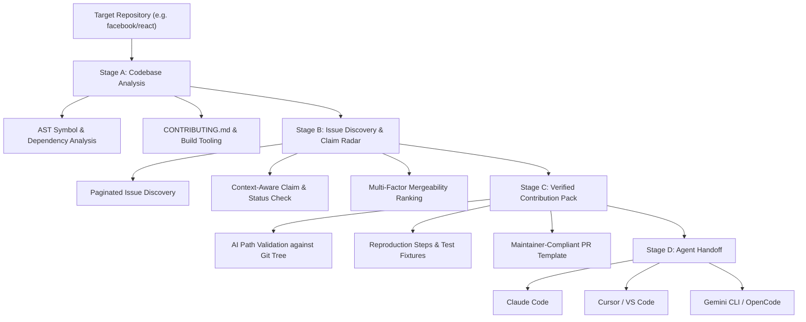

# ContribPilot

<p align="center">
  
</p>

<p align="center">
  <a href="https://github.com/sayandeep0212/ContribPilot/actions"></a>
  <a href="https://www.npmjs.com/package/contribpilot"></a>
  <a href="LICENSE"></a>
  <a href="https://github.com/sayandeep0212/ContribPilot/stargazers"></a>
  <a href="https://github.com/sayandeep0212/ContribPilot"></a>
</p>

> **AI-powered open-source contribution assistant** that helps developers find, plan, diagnose, and land **mergeable** pull requests in minutes.  
> Powered by your personal **Google Gemini** quota ($0 setup) with automatic **Groq LPU** failover.

---

## 📖 Overview

Over **82% of first-time open-source contribution attempts are abandoned** due to broken local toolchains, missed `CONTRIBUTING.md` guidelines, unverified AI code suggestions, or working on stale, duplicate issues.

**ContribPilot** is an intelligent terminal copilot designed to eliminate open-source onboarding friction. ContribPilot inspects repository structure and AST syntax trees, analyzes contribution policies, discovers unassigned tickets matching your skill level, validates AI-suggested files against the real git tree, and prepares a fully grounded, maintainer-compliant **Contribution Pack** with automated unit test reproduction.

- **Developer**: [Sayandeep Pradhan](https://github.com/sayandeep0212)
- **Repository**: [https://github.com/sayandeep0212/ContribPilot](https://github.com/sayandeep0212/ContribPilot)
- **License**: Apache 2.0 Open Source

---

## 🌟 Key Features

### 1. 🔍 Syntax-Aware AST Codebase Analysis

- **TypeScript & JavaScript AST Parsing**: Uses the TypeScript Compiler API to extract declared functions, classes, interfaces, exported symbols, and module dependency relationships.
- **Issue-to-Code Correlation**: Matches keywords and tokens from issue descriptions directly to relevant source files and symbol declarations.
- **Multi-Language Fallback**: Retains fast heuristic and manifest inspection for Python, Go, Rust, Java, and C/C++.

### 2. 📡 Context-Aware Contributor Claim Radar

- **Smart Evidence Extraction**: Analyzes issue comment streams while ignoring blockquotes and historical conversational noise.
- **Intent vs. Action**: Distinguishes between past-tense inquiries ("_Did anyone work on this?_") and active commitments ("_I am working on a PR for this_").
- **Abandonment & Status Tracking**: Identifies explicit unassignments, abandoned claims, and stale activity, assigning each candidate issue a claim status (`active`, `stale`, `abandoned`) and confidence score (`HIGH`, `MEDIUM`, `LOW`).

### 3. 🎯 Multi-Factor Issue Ranking & File Verification

- **Mergeability Scoring**: Evaluates candidate issues by maintainer responsiveness, issue clarity, and newcomer friendliness (`beginner`, `intermediate`, `pro`).
- **Git Tree File Validation**: Validates all AI-suggested file paths against the repository's git tree to separate verified source targets from speculative hypotheses.

### 4. 📦 Evidence-Grounded Contribution Packs

- **Deterministic Issue Targeting**: Never silently substitutes issues; targets the exact requested issue with strict error recovery.
- **Root-Cause Analysis**: Grounds diagnostic hypotheses and affected files in verified repository evidence, explicitly labeling assumptions.
- **Reproduction & Test Plan**: Generates step-by-step reproduction instructions and unit test templates to verify fixes prior to PR submission.
- **Maintainer-Compliant PR Descriptions**: Formats PR bodies following the target repository's contribution guidelines.

### 5. 🛡️ Hardened Security & Secret Auditing (`contribpilot audit`)

- **Expanded Secret Detection**: Scans recent commits and sensitive files for exposed credentials across 10+ patterns (Slack webhooks, Stripe keys, OpenAI/Anthropic API keys, AWS credentials, GitHub PATs, JWT tokens, and database URIs).
- **CI/CD & Container Hygiene**: Checks GitHub Actions workflows for dangerous `pull_request_target` checkouts and script injection vulnerabilities, and verifies non-root container user directives.
- **Transparent Classification**: Clearly distinguishes deterministic pattern matches (`VERIFIED_PATTERN`) from heuristic checks (`HEURISTIC`), complete with remediation guidance and documented audit limitations.

### 6. 🔐 Enterprise-Grade Key Management

- **OS Keychain Integration**: Prioritizes native operating system keychains (macOS Keychain, Windows Credential Manager, Linux Secret Service).
- **Encrypted Local Vault**: Fallback credentials are encrypted using AES-256-GCM with a 256-bit cryptographically secure random key file (restricted to permissions `0600`) or PBKDF2 with unique salts, supporting automatic migration from legacy vaults.
- **Rate-Limit Resilience**: Resolves GitHub tokens seamlessly across Keychain, `.vault`, `GITHUB_TOKEN`, `GH_TOKEN`, and `gh auth token`. Prompts interactively on HTTP 403 rate limits so workflows never fail abruptly.

### 7. 🤖 Direct AI Coding Agent Handoff

- Directly exports the Contribution Pack and context to local coding agents:
  - **Claude Code** (`claude`)
  - **Gemini CLI** (`gemini`)
  - **Cursor** (`cursor`)
  - **OpenCode** (`opencode`)
  - **VS Code** (`code`)

---

## ⚡ Quickstart (Zero Installation)

Run ContribPilot instantly with `npx` or `pnpm dlx`:

```bash
# Run guided flow on any public repository
npx contribpilot start facebook/react

# Or with pnpm
pnpm dlx contribpilot start shadcn-ui/ui
```

Or install globally:

```bash
npm install -g contribpilot
contribpilot --help
```

---

## 🚀 CLI Commands & Interactive Palette

ContribPilot features an **interactive slash command palette** (`/`). Press `/` anywhere in an interactive prompt to open the fuzzy search palette.

| Command                            | Description                                                                         |
| :--------------------------------- | :---------------------------------------------------------------------------------- |
| `contribpilot start [repo]`        | **Full guided flow**: repo analysis ➔ level select ➔ ranked issues ➔ pack ➔ PR diff |
| `contribpilot analyze <repo>`      | **Stage A**: Codebase architecture, build commands, and contribution rules          |
| `contribpilot issues <repo>`       | **Stage B**: Discover, rank, and inspect mergeable issues with evidence scoring     |
| `contribpilot pack <repo> <issue>` | **Stage C**: Generate an evidence-grounded Contribution Pack for a specific issue   |
| `contribpilot audit <repo>`        | **[PRO]** Scan repo health, code structure, secret leaks, and security posture      |
| `contribpilot config`              | Interactive configuration for GitHub PAT, Gemini API key, Groq key, and Pro token   |
| `contribpilot level [level]`       | Switch contributor experience level (`beginner` \| `intermediate` \| `pro`)         |
| `contribpilot quota`               | Inspect Google Gemini RPM/TPM quota, Groq LPU failover, and model status            |
| `contribpilot agents`              | Detect and list installed AI coding agents on your device                           |
| `contribpilot upgrade` / `/pro`    | Activate ContribPilot Pro via **Dodo Payments** for hosted quota & deep audits      |
| `contribpilot doctor`              | Run environment diagnostics (Node, Git, Keychain, Network, API keys)                |
| `contribpilot login`               | Authenticate with Google OAuth (Loopback Server + PKCE)                             |
| `contribpilot logout`              | Safely wipe stored tokens and credentials from OS keychain/vault                    |
| `contribpilot whoami`              | Show current authenticated user profile, auth method, and quota status              |
| `contribpilot cache <action>`      | Inspect or clear local caches (`cache stats` \| `cache clear`)                      |
| `contribpilot about`               | Show version, developer credits, and architecture overview                          |

---

## 🏗️ Monorepo Architecture

ContribPilot is built as a high-performance modular monorepo managed with **pnpm** and **Turborepo**:

```
ContribPilot/
├── apps/
│   ├── cli/            # Interactive terminal CLI (@clack/prompts, Commander, chalk)
│   └── web/            # Modern React + Vite showcase landing page & dashboard
└── packages/
    ├── analyzer/       # AST code analysis (TS Compiler API) & security health auditor
    ├── auth/           # OS Keychain & AES-256-GCM secure vault key management
    ├── core/           # Core orchestration engine (discovery, ranking, packs)
    ├── github/         # GitHub REST client, pagination, caching, claim radar
    ├── handoff/        # Coding agent adapters (Claude Code, Gemini CLI, Cursor, etc.)
    ├── llm/            # Multi-provider LLM abstraction (Gemini 2.0 Flash + Groq LPU)
    ├── pack/           # Evidence-grounded Contribution Pack generator
    ├── ranker/         # Multi-factor issue ranker & AI git tree file path validator
    └── shared/         # Common TypeScript types, logger, errors, and redaction utilities
```

---

## 🔄 End-to-End Workflow



---

## 🔐 Security & Privacy Model

- **100% Free Quota ($0 Setup)**: Connects directly to Google's official free Gemini API allowance (15 requests/min, 1,000,000 tokens/min) with optional Groq failover.
- **Local Credential Storage**: Sensitive tokens are stored in the OS credential manager or an AES-256-GCM encrypted `.vault` with restrictive permissions (`0600`) and cryptographically random key derivation.
- **Zero Telemetry**: No source code, personal tokens, or repository contents are sent to third-party tracking servers.
- **Local Loopback OAuth**: Google OAuth runs entirely on `127.0.0.1` with PKCE and cryptographic state validation to prevent CSRF attacks.

---

## 💳 ContribPilot Pro (Powered by Dodo Payments)

For active engineers, staff developers, and teams:

- **Hosted Gemini 1.5 Pro AI Quota**: Zero Google Cloud setup required.
- **Deep Repository Security Audit (`contribpilot audit <repo>`)**: Comprehensive secret leak detection, CI/CD misconfiguration checks, and container security posture.
- **Multi-Repo Batch Analysis & Priority AST Reasoning**.

Run in your terminal to activate:

```bash
contribpilot upgrade
# Or with a purchased license key:
contribpilot upgrade --key cp_pro_xxxxxxxx
```

---

## 🛠️ Local Development & Testing

### Prerequisites

- **Node.js**: `>= 20.0.0`
- **pnpm**: `>= 9.0.0` (Recommended: `pnpm@12.x`)

### Setup

```bash
# Clone the repository
git clone https://github.com/sayandeep0212/ContribPilot.git
cd ContribPilot

# Install dependencies
pnpm install

# Build all monorepo packages
pnpm build

# Run the CLI locally
pnpm cli start facebook/react
```

### Quality & Test Suite

```bash
# Run Vitest across all 7 package test suites (31 unit tests)
pnpm test

# Typecheck all packages
pnpm typecheck

# Lint codebase (ESLint 9 Flat Config)
pnpm lint

# Check Prettier formatting
pnpm format:check
```

---

## 🌐 Web Showcase

Preview the modern showcase web app locally:

```bash
pnpm web
# Open http://localhost:3000
```

Build the production web bundle:

```bash
pnpm web:build
```

---

## 🤝 Contributing & Community

We welcome contributions of all kinds! Please read our [CONTRIBUTING.md](CONTRIBUTING.md) guide for details on code style, branch workflows, and pull request submissions.

All contributors are expected to adhere to our [Code of Conduct](CODE_OF_CONDUCT.md).

---

## 👨‍💻 Developer & License

Engineered with ❤️ by **Sayandeep Pradhan** ([@sayandeep0212](https://github.com/sayandeep0212)).

Licensed under the **[Apache-2.0 License](LICENSE)**.
